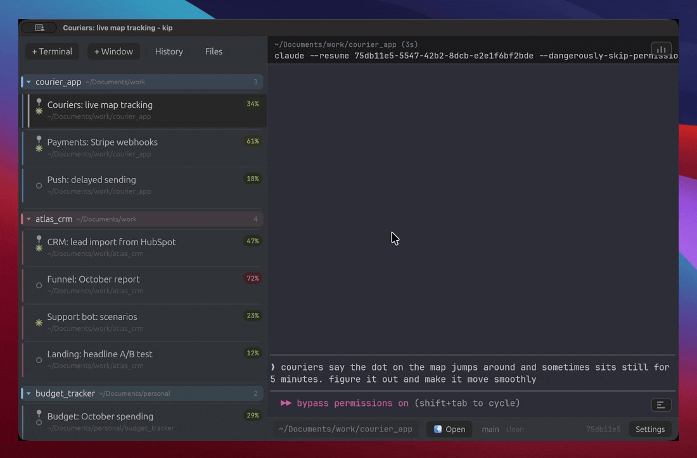
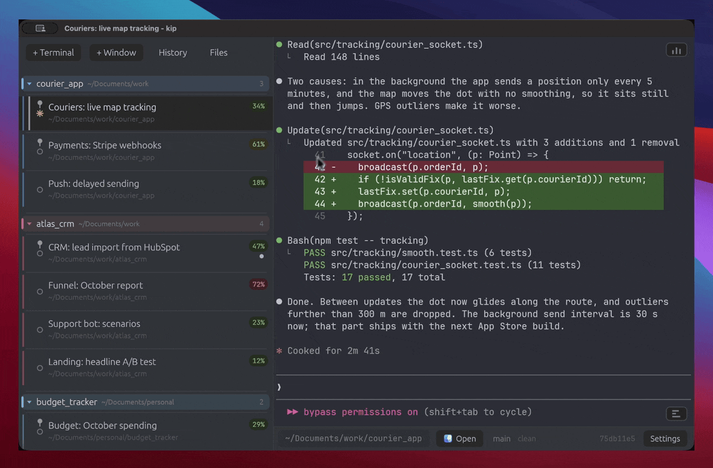
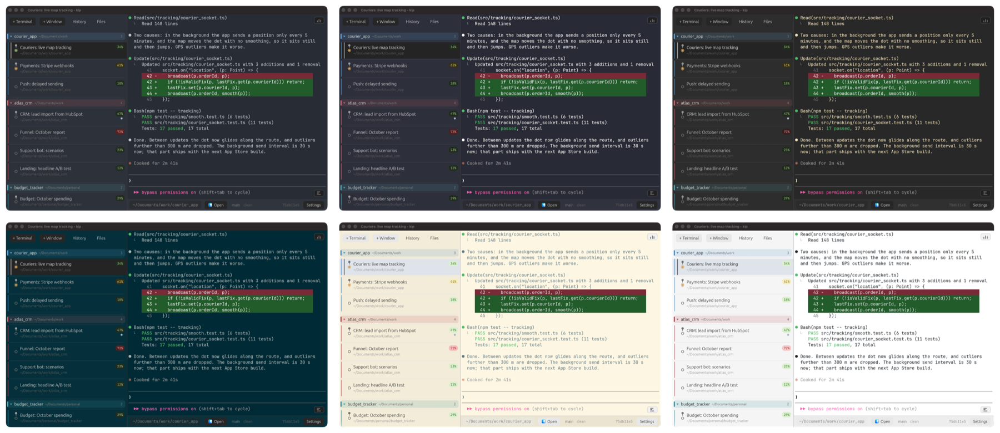

<div align="center">
  
  <h1>kip</h1>
  <p><b>Run a dozen Claude Code agents without losing track of any.</b></p>
  <p>
    <a href="https://github.com/densharik/kip/releases/latest">Download for macOS / Windows</a>
    &nbsp;·&nbsp; <a href="#install">Install</a>
    &nbsp;·&nbsp; <a href="#mcp-claude-drives-kip">MCP</a>
    &nbsp;·&nbsp; <a href="#faq">FAQ</a>
  </p>
  
</div>

- **See every agent at a glance.** Who is working, who is done and waiting for you, how full each context window is.
- **Put idle sessions to sleep and get the RAM back.** The conversation is still there; one click brings it back.
- **Find any past conversation** by what was said in it, across all your projects.

kip is a real terminal, not a Claude client: it runs the `claude` CLI on a real
PTY, so every Claude Code feature and flag works the day it ships, and so do
`vim`, `ssh` and everything else. One native Rust binary, no Electron.

## At a glance

Every session is a row: name, folder, what it is doing, and a context badge
(green under 50%, yellow to 70%, red above). When an agent finishes in the
background, its row lights up and you get a system notification. Group sessions
by dragging one onto another, or switch the list to sort itself by project (git
root); pin the ones that must not be closed or put to sleep by accident. Your Claude
subscription limits sit in the corner, the same numbers `/usage` shows.

## Sleep and wake


A sleeping session costs nothing: kip kills its whole process tree and keeps the
screen as text. Resume brings the same conversation back with
`claude --resume`. Idle sessions fall asleep on their own after 10 minutes (a
running build never counts as idle), and every session survives quitting kip.

## History



`Cmd+Y` lists every Claude Code conversation on disk. Type to search what you
and Claude actually said (not tool output), across all projects, in a fraction
of a second; matches are highlighted in the preview, and Enter continues the
conversation in a new tab.

## Let Claude drive


kip ships an MCP server, so Claude in any session can open, close, rename,
sleep and wake sessions, read their screens, and search history when you ask.
See [MCP](#mcp-claude-drives-kip) for the tool list.

## Also



- Themes: One Dark, Dracula, Gruvbox, Solarized, Solarized Light, GitHub Light and more, plus your own accent color.
- `Cmd+F` searches the screen and scrollback; other sessions with hits get marked in the list.
- Clickable file paths, drag a file in to insert its path, paste a screenshot to insert a path to it.
- Several windows; each session can move between them. `Cmd+1`..`Cmd+9` jumps to a session.
- RAM and CPU per session, git status of the active folder.
- Command bar with history, directory switcher, file explorer panel; `Cmd+Z` undoes the last edit in Claude's prompt.
- macOS: "New kip Window Here" in Finder's Services menu. Claude Code mods can draw badges and cards in kip (see [Mods](#mods)).
- English and Russian. Updates itself; every release is signed and verified before it installs.

## Install

Grab the latest build from [Releases](https://github.com/densharik/kip/releases).
After that kip updates itself, so this is a one-time step.

**macOS** - open `kip-installer.pkg`. It is not notarized, so right-click the
`.pkg` and choose Open the first time, then follow the installer. Installed this
way it launches with no Gatekeeper warning.

**Windows** - download `kip.exe` and run it. Single portable binary, put it
anywhere.

**From source** - needs a stable Rust toolchain (edition 2024) and Zig 0.17
(the terminal core, libghostty-vt, is built from the `vendor/ghostty` submodule):

```
git clone --recursive https://github.com/densharik/kip
cd kip
cargo build --release
```

## FAQ

### How do I suspend a Claude Code session to free RAM?

Right-click the session and pick Suspend, or let the idle timer do it. kip kills
the session's entire process tree, so the memory actually goes back to the OS -
it is not a paused or backgrounded process. The screen is kept as text, and
Resume Claude brings the same conversation back with `claude --resume <id>`.

### Do Claude Code sessions survive closing the terminal?

Yes. kip writes every session to disk - working directory, name, group, pin, the
last 32 KB of its screen, and the Claude conversation id - so quitting the app
and reopening it gives you the same list. There is nothing to save by hand.
State lives in `~/Library/Application Support/kip/state.json` on macOS,
`~/.config/kip/state.json` on Linux, `%APPDATA%\kip\state.json` on Windows.

### Can Claude Code sessions be suspended automatically?

Yes. Settings has "Suspend after (min)", 10 by default. A session that has
produced no output and seen no input for that long is suspended. An interactive
Claude sitting at its prompt counts as idle, but a foreground job that is
actually running does not, so a long build or sync is never cut off. Pinned and
"keep awake" sessions are skipped.

### Is kip a terminal or a GUI app for Claude?

A terminal. kip drives a real PTY (ConPTY on Windows) and launches the real
`claude` CLI in it - it does not talk to the Anthropic API itself and does not
reimplement Claude's interface. Every Claude Code feature, flag, and update works
the day it ships, and you can run any other command in the same session.

### How do I see how full a Claude Code session's context window is?

Every session row carries a percentage badge. kip reads it two ways: from the
session transcript under `~/.claude/projects` (works everywhere, no setup), or
exactly, straight from Claude, if you turn on the statusline hook in settings.

### Can I run several Claude Code agents at once?

That is what the sidebar is for. Each session is its own shell in its own
directory with its own Claude conversation, and the badges tell you which agent
is about to run out of context and which one is idle waiting for you. Sessions
you are not using can sleep so they cost nothing, and the "Active" toggle above
the list hides them until you need them again.

### How much memory does kip use?

kip itself sits around 200 MB. Each live session costs whatever its shell and
`claude` process cost; a suspended session costs nothing beyond a few KB of saved
text. The resource panel shows both.

## Context percent

Claude Code computes the percentage at runtime and never writes it to disk, so
kip gets it two ways. By default it reads the session transcript under
`~/.claude/projects` and estimates from the last token count - works everywhere,
no setup. Turn on the statusline hook in settings (macOS/Linux) and Claude feeds
kip the exact number it shows itself, about once a second.

## Mods

A Claude Code mod (a plugin of function hooks running inside `claude`) can
show things in kip without any kip code. It writes
`~/.kip/mods/<mod>/<claude session id>.json`, and kip draws a badge in that
session's row and a card over its terminal:

```json
{
  "updatedAt": 1760000000000,
  "ttlMs": 5000,
  "badge": { "text": "VPN", "tone": "ok", "hint": "shown on hover" },
  "card": {
    "title": "Running bash: 1",
    "tone": "busy",
    "rows": [
      { "text": "Run tests", "style": "strong" },
      { "text": "test a ... ok", "style": "mono" }
    ]
  }
}
```

Every field is optional. `ttlMs` hides the view once the mod stops refreshing
it (its `claude` exited); without it the view stays until the file changes.
Tones: `info`, `ok`, `warn`, `error`, `busy`, `dim`. Row styles: `text`,
`strong`, `mono`, `dim`, `faint`. ANSI colors in the text are stripped. A click
on a card's title folds it.

## MCP: Claude drives kip

kip ships its own MCP server, so Claude in any session can manage kip when you
ask: "open a session in ~/work/api with Claude", "summarize what the portfolio
sessions are doing", "put everything idle for two hours to sleep".

kip offers to install it on first launch (Settings > MCP has the same button),
or by hand:

```sh
claude mcp add -s user kip -- /Applications/kip.app/Contents/MacOS/kip mcp
```

Small on context: 24 tools, about 7.6 KB of schema (~2.1k tokens) - and Claude
Code usually defers MCP tools, keeping only their names in context until one
is used. If kip is not running, the first call starts it.

| Tool | Does |
|---|---|
| `list_sessions`, `list_windows` | sessions with folder, group, project, window, state, busy, finished-unseen, pinned, context %, idle time |
| `open_session` | new terminal in a folder: plain, with Claude, `--resume <id>`, or a command; window, group, name |
| `close_session`, `suspend_session`, `wake_session` | pinned sessions refuse to close without `force` |
| `focus_session`, `rename_session`, `set_group`, `pin_session` | |
| `style_group` | color a group or project section, move it up or down |
| `open_folder` | open a session's folder in Finder / Explorer |
| `open_window`, `move_to_window` | |
| `save_state` | write sessions and windows to disk now |
| `read_screen`, `read_transcript` | terminal text and the Claude conversation (also a past one by `sid`), for summaries |
| `list_history`, `show_history` | past Claude conversations on disk, searched by title and text; open kip's history browser |
| `search` | case-insensitive text search across sessions' screen and scrollback |
| `send_input` | type into a session - off until enabled in Settings |
| `cleanup` | suspend or remove long-idle sessions; dry run by default |
| `get_settings`, `set_settings` | read and change any kip setting |

Under the hood kip listens on 127.0.0.1 with a per-run token in
`~/.kip/ctl.json` (readable by you only); `kip mcp` relays tool calls there.

## Platform support

|                          | macOS | Linux | Windows |
|--------------------------|:-----:|:-----:|:-------:|
| Terminal, sessions, themes |  yes  |  yes  |   yes   |
| Suspend / resume, persistence | yes | yes |   yes   |
| Context badge (estimate)   |  yes  |  yes  |   yes   |
| Exact context hook         |  yes  |  yes  |    -    |
| File/image paste           |  yes  |  yes  |  text   |

Windows runs on ConPTY with PowerShell. Items marked `-` fall back gracefully.

## License

Apache-2.0. See [LICENSE](LICENSE).
